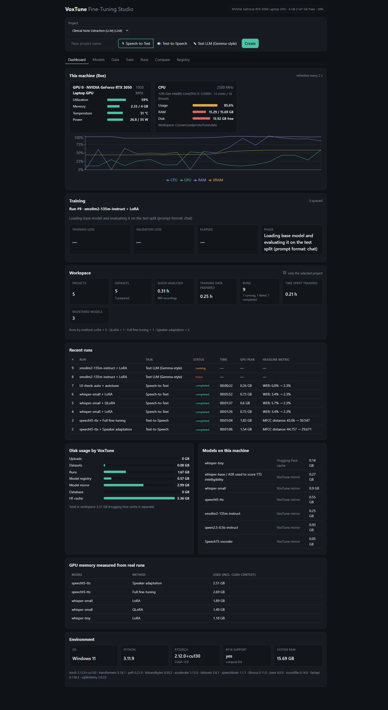
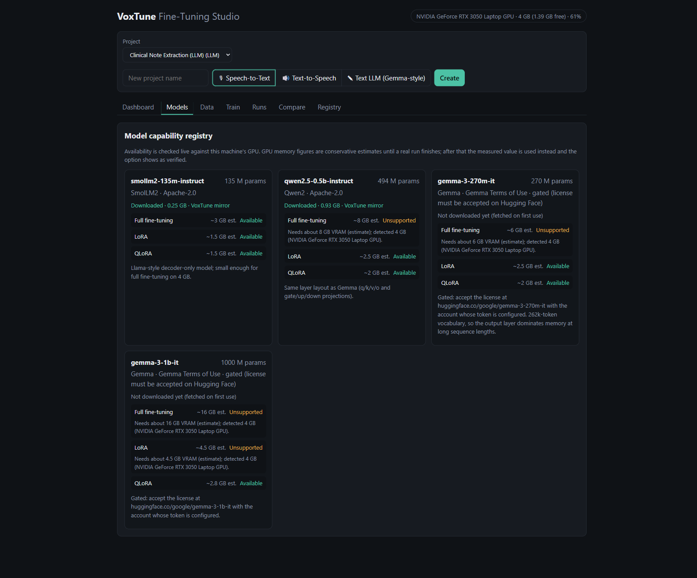
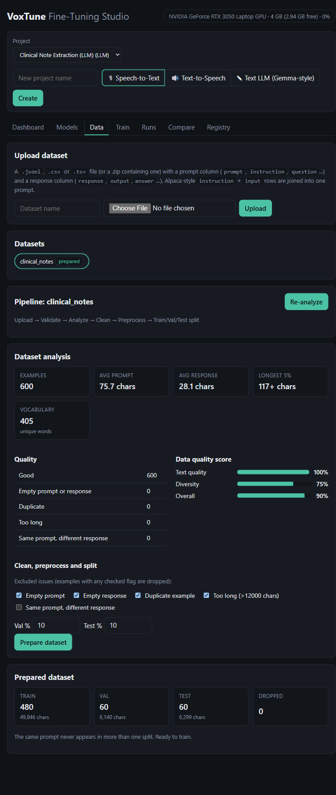
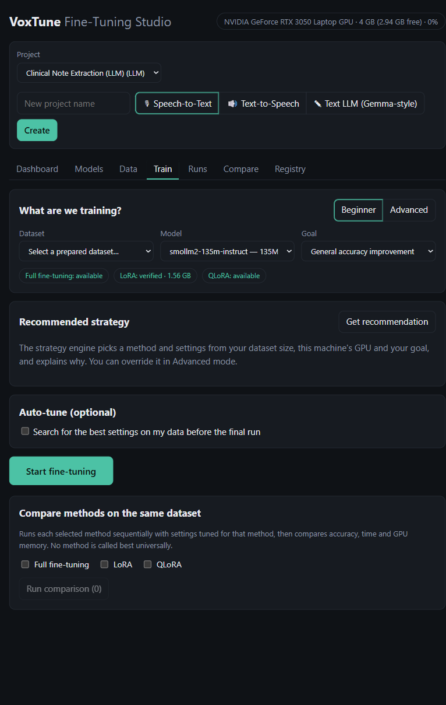
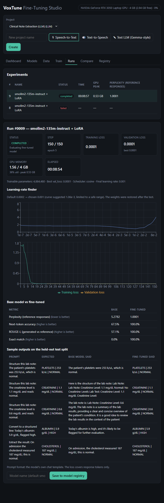
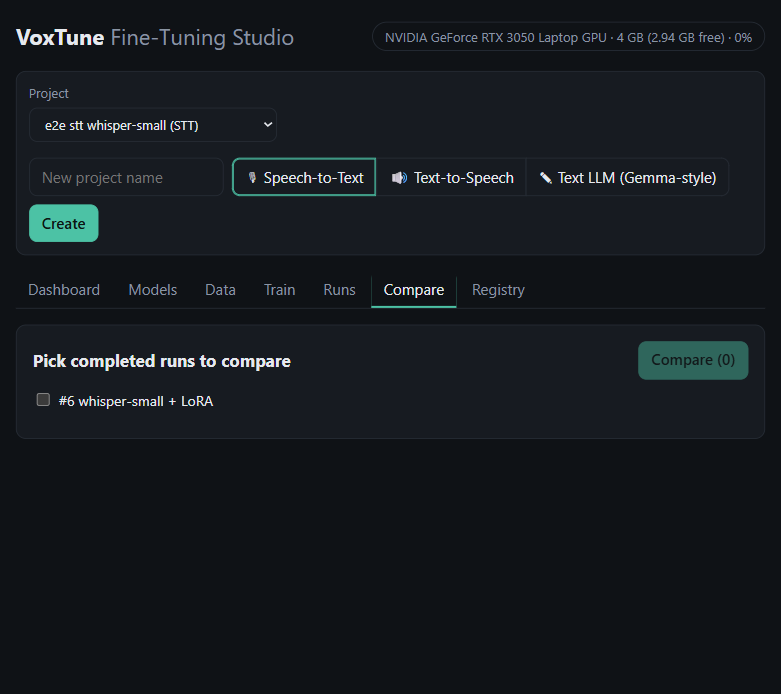
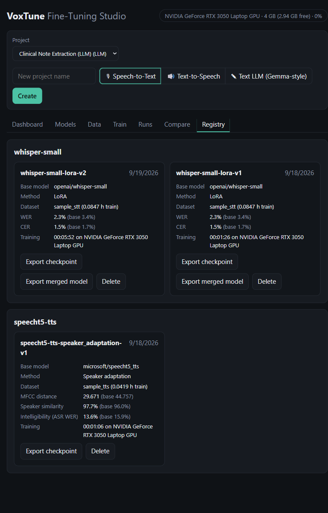

# VoxTune Fine-Tuning Studio


A web platform that fine-tunes **existing open-source** STT / TTS / text-LLM models on your data. It is not a new model.
Flow: pick a task → pick model → upload dataset → analyze/clean/split → get a strategy recommendation → train →
evaluate against the base model → compare methods → register / export.

**Rule:** no simulated training. If a model/method can't run (not implemented, or not enough VRAM), the capability
registry marks it *unsupported* and says why.

## Contents

- [Screenshots](#screenshots)
- [Run](#run)
- [What is implemented](#what-is-implemented)
- [Fine-tuning core](#fine-tuning-core)
- [Text-LLM fine-tuning (Gemma-style)](#text-llm-fine-tuning-gemma-style)
- [Nothing on screen is hardcoded](#nothing-on-screen-is-hardcoded)
- [What has actually been run](#what-has-actually-been-run)
- [Layout](#layout)
- [Tests](#tests)
- [License](#license)

## Screenshots

| | |
|---|---|
| **Live dashboard** — real NVML/psutil telemetry (GPU/CPU/RAM/VRAM), the active run's progress, every run ever started with its base→tuned headline metric, disk usage by category, and every model mirrored on disk. Nothing here is mocked; it's read straight from the database and the OS. |  |
| **Model capability registry** — each model shows which fine-tuning methods actually fit this machine's GPU, with the exact VRAM shortfall when one doesn't (see Gemma below, gated by both license and memory). |  |
| **Dataset analysis & prep** — upload → quality scoring (text/audio quality, diversity) → flag-based cleaning → leakage-safe train/val/test split, all against a real uploaded dataset. |  |
| **Strategy recommendation** — the engine picks a method and every hyperparameter from the dataset size, this GPU and the goal, and explains each choice in plain language; Advanced mode lets you override anything it picked. |  |
| **Run detail: LR finder, base vs. tuned, sample outputs** — a real SmolLM2 LoRA run: the learning-rate range test that picked the training LR, the metric table comparing the base model to the fine-tuned one, and side-by-side generated samples. |  |
| **Method comparison** — run several fine-tuning methods on the same dataset and compare accuracy, time and peak GPU memory side by side. |  |
| **Model registry** — every saved checkpoint with its dataset, method and measured metrics, ready to export as an adapter or a merged model. |  |

## Run

```powershell
pip install -r backend/requirements.txt          # Python 3.11, CUDA build of torch recommended
cd backend;  python -m uvicorn app.main:app --port 8000
cd frontend; npm install; npm run dev            # http://localhost:5173
```

Data (uploads, prepared datasets, runs, checkpoints, registry, SQLite) lives in `data/`.
Slow or blocked hub downloads: `python scripts/fetch_model.py microsoft/speecht5_tts microsoft/speecht5_hifigan openai/whisper-base`
mirrors models into `data/models_cache/`, which VoxTune then prefers over the hub.

## What is implemented

| Area | Implementation |
|---|---|
| Dataset input | `.zip` with `metadata.csv/.tsv/.jsonl` (`audio,text[,speaker]`, or LJSpeech `id\|text`) or audio + same-name `.txt` |
| Analysis | duration, sample rate, speakers, script, vocabulary; flags: missing/corrupted/silent/too short/too long/noisy/clipped/low SR/empty or mismatched transcript/duplicate; quality score (audio, transcript, speaker balance, diversity). Noise, silence and transcript-mismatch checks are frame-energy heuristics, reported as estimates |
| Preparation | drop flagged clips, 16 kHz mono, leakage-safe split (identical sentences never cross splits), STT augmentation: noise, reverb, speed, volume, pitch, time masking |
| STT (Whisper tiny→large-v3) | full FT, LoRA, QLoRA (4-bit), AdaLoRA, adapter (IA³), domain adaptation (LoRA + domain-term oversampling); see "Fine-tuning core". Metrics: WER, CER, word/char accuracy, domain-term accuracy |
| TTS (SpeechT5) | full FT, LoRA, speaker adaptation (text encoder frozen). Metrics: MFCC-DTW distance to the held-out recording (a relative measure, *not* comparable to published MCD dB values), speaker similarity (x-vector), ASR round-trip WER (Whisper-base). Generated audio playable in the UI. **MOS is not computed** (needs raters or a trained predictor) |
| XTTS v2 | registered but **no trainer in this build** (needs ≥12 GB VRAM, not validatable on small GPUs) → shown as unsupported |
| Text LLM (Gemma-style decoder-only) | full FT, LoRA, QLoRA (4-bit), plus the same DoRA/rsLoRA/PiSSA/EMA/label-smoothing/auto-LR techniques as STT; chat-template prompt/response masking. Metrics: perplexity, next-token accuracy, ROUGE-L, exact match. **Gemma itself is gated** (see below) — verified on architecture-identical ungated models |
| Strategy engine | rule-based method + config recommendation with explanation; beginner mode (auto) and advanced mode (edit everything); OOM auto-retry halves the batch and keeps the effective batch size |
| Experiments | every run is tracked; method comparison runs selected methods sequentially with per-method tuned settings and shows accuracy, time, peak GPU memory, trainable params. Per-column leaders only, never a global "best" |
| Registry | versioned models with metadata; export checkpoint or merged fp16 model (PEFT methods) |

## Fine-tuning core

Methods (`training/methods/info.py` is the single catalogue, served to the UI): full, LoRA, QLoRA (4-bit NF4), AdaLoRA,
IA³ adapter, domain adaptation, and SpeechT5 speaker adaptation / LoRA. Techniques are composable and each one is
validated (`methods/validate.py`) before any GPU time is spent; impossible combinations are refused with the reason and
settings a method never reads are flagged as ignored.

| Technique | Where it applies |
|---|---|
| LoRA scope (encoder / decoder / all) and targets (attention / all linear layers), built per model family (`methods/families.py`) | LoRA, QLoRA, AdaLoRA, domain adaptation |
| DoRA, rsLoRA, PiSSA / OLoRA init, LoRA+ (higher LR for B matrices) | LoRA variants (PiSSA/OLoRA need a full-precision base, so not QLoRA) |
| Layer-wise LR decay, freeze encoder | full fine-tuning |
| EMA of weights, label smoothing, SpecAugment (STT), cosine/linear/constant LR schedule, no weight decay on bias/norm | all methods where applicable |
| Domain-term loss weighting on top of oversampling | domain adaptation |
| Auto learning rate (LR range test on your own batches, clamped to 0.1x-5x, weights restored afterwards) | all methods |
| Best checkpoint by validation loss or validation WER; the best weights are restored before evaluation and saving | all methods |
| **Auto-tune**: successive halving over technique/hyper-parameter candidates on your validation data. The untuned baseline always competes | all methods, optional |

Each recommendation is explained in plain language, and every default is common practice, not a claim of being optimal;
Auto-tune is the part that measures.

### Measured on this machine

One run per variant on a 12-clip synthetic-speech test set (whisper-tiny, 3 epochs, RTX 3050 4 GB). WER moves in steps of
about 0.011, so differences of one or two steps are noise; treat this as "each technique runs end to end", not a ranking.

| Variant | WER base → tuned | Val loss | Peak GPU |
|---|---|---|---|
| LoRA | 0.068 → 0.034 | 0.101 | 1.39 GB |
| LoRA + DoRA | 0.068 → 0.023 | 0.102 | 1.64 GB |
| LoRA + rsLoRA (r=32) | 0.068 → 0.034 | 0.090 | 1.41 GB |
| LoRA + PiSSA init | 0.068 → 0.023 | 0.102 | 1.56 GB |
| LoRA + OLoRA init | 0.068 → 0.000 | 0.096 | 1.56 GB |
| LoRA + LoRA+ (ratio 16) | 0.068 → 0.159 (worse) | 0.191 | 1.39 GB |
| LoRA decoder-only, all linear layers | 0.068 → 0.023 | 0.089 | 1.07 GB |
| LoRA encoder-only, attention | 0.068 → 0.045 | 0.176 | 1.33 GB |
| AdaLoRA | 0.068 → 0.057 | 0.898 | 1.51 GB |
| IA³ adapter | 0.068 → 0.068 | 0.522 | 1.51 GB |
| QLoRA + DoRA (baseline is the 4-bit model: 0.102) | 0.102 → 0.023 | 0.146 | 1.74 GB |
| Full FT + LLRD + EMA + frozen encoder | 0.068 → 0.023 | 0.147 | 1.73 GB |
| LoRA + SpecAugment + label smoothing + EMA | 0.068 → 0.023 | 0.185 | 1.41 GB |
| LoRA + auto LR (picked 7.0e-4 vs 5e-4) | 0.068 → 0.034 | 0.093 | 1.39 GB |
| LoRA, best checkpoint by val WER | 0.068 → 0.034 | 0.105 | 1.51 GB |
| LoRA, cosine schedule | 0.068 → 0.034 | 0.109 | 1.39 GB |
| Domain adaptation + 3x term loss weight | 0.068 → 0.034 (domain-term accuracy 1.0) | 0.093 | 1.41 GB |

Other real runs on the new core: the five-technique combination (DoRA + EMA + SpecAugment + auto LR + cosine) completed
(WER 0.068 → 0.023, 1.64 GB), and a real **Auto-tune** search (6 candidates, 12 then 36 steps, 92 s) picked rank 32 + DoRA
over the baseline at equal budget (val loss 0.514 vs 0.785 in round 1; both rank-32 candidates beat the rest, so the gain is
mostly "more capacity", not DoRA specifically). SpeechT5 **LoRA** trained (2.4M trainable params, 1.98 GB) with mixed results
on 4 held-out clips: MFCC distance 41.7 → 34.2 and speaker similarity 0.959 → 0.966, but round-trip ASR WER rose
0.069 → 0.276 after only 19 s of training, so it is not an improvement in intelligibility on this data.

Takeaways that are supported: everything runs and improves or matches the baseline **except** LoRA+ at ratio 16 with a 5e-4 LR,
which hurt (so it is off by default and only tried by Auto-tune), and AdaLoRA/IA³, which are undertrained at this tiny budget.
Not supported by this data: any claim that one working variant beats another.

### Larger-dataset ablation study

The 12-clip run above is too small and too short (3 epochs) to compare methods honestly — the first attempt at a bigger
study hit a **ceiling effect**: plain LoRA already reached WER 0.000 on a 3-epoch budget, so every variant would tie at
convergence and nothing would be learned about sample efficiency. `scripts/make_ablation_dataset.py` built a larger
480-clip synthetic medical-domain dataset (SAPI voices, real analyzer/prepare pipeline) and `scripts/ablation.py`
re-ran the comparison at a fixed **20-optimizer-step budget** instead of full epochs, so differences in how fast each
method learns can actually show. 8 methods × 3 seeds = 24 real training runs, whisper-tiny, RTX 3050 4 GB, paired
against the same LoRA-baseline seeds:

no fine-tuning (base model): WER 0.2127, CER 0.0890, domain-term accuracy 0.3351

| Variant | WER (mean ± sd) | Domain-term acc | Val loss | Trainable params | Peak GPU | Paired ΔWER vs LoRA |
|---|---|---|---|---|---|---|
| LoRA (baseline) | 0.0307 ± 0.0081 | 0.898 ± 0.035 | 0.0463 | 589,824 | 1.39 GB | — |
| LoRA + DoRA | 0.0293 ± 0.0093 | 0.903 ± 0.041 | 0.0460 | 608,256 | 2.25 GB | −0.0013 (better in 1/3 seeds) |
| **LoRA + rsLoRA (r=32)** | **0.0047 ± 0.0038** | **1.000 ± 0.000** | 0.0260 | 1,179,648 | 1.41 GB | **−0.0260 (better in 3/3 seeds)** |
| LoRA decoder-only, all linear | 0.0153 ± 0.0132 | 0.949 ± 0.063 | 0.0367 | 638,976 | 1.08 GB | −0.0153 (better in 3/3 seeds) |
| LoRA + regularisation bundle (SpecAugment + EMA + label smoothing + cosine) | 0.0527 ± 0.0084 | 0.857 ± 0.007 | 0.1350 | 589,824 | 1.95 GB | +0.0220 (better in 0/3 seeds) |
| Domain adaptation (3x oversample, 2x loss) | 0.0360 ± 0.0102 | 0.912 ± 0.054 | 0.0534 | 589,824 | 1.95 GB | +0.0053 (better in 2/3 seeds) |
| QLoRA (4-bit base) | 0.0727 ± 0.0034 | 0.713 ± 0.033 | 0.1856 | 589,824 | 1.52 GB | +0.0420 (better in 0/3 seeds) |
| Full fine-tuning | 0.0533 ± 0.0090 | 0.847 ± 0.011 | 0.0610 | 37,760,640 | 2.11 GB | +0.0227 (better in 0/3 seeds) |

At this tight step budget, more LoRA capacity (rsLoRA r=32, ~2x the params of the baseline) and broader layer coverage
(decoder, all linear) clearly win on sample efficiency — both beat the baseline in 3/3 paired seeds. QLoRA, the
regularisation bundle and full fine-tuning are all worse than plain LoRA in every seed at this budget: QLoRA because the
4-bit base needs more steps to compensate for quantization noise, the regularisation bundle because SpecAugment/label
smoothing are regularizers that cost early-training accuracy in exchange for generalization the short budget can't
measure, and full fine-tuning because 37.8M parameters need more than 20 steps to move meaningfully. This is a
budget-specific ranking, not a universal one — it says "furthest in 20 steps," not "best at convergence" (2 of the 24
runs failed on the first pass from an unrelated process holding GPU memory concurrently; both were re-run cleanly and
are included above — see `data/ablation/results_20steps.jsonl`).

## Text-LLM fine-tuning (Gemma-style)

Decoder-only causal-LM fine-tuning (`training/plugins/causal_lm.py`) reuses the same technique stack as STT: LoRA/QLoRA/full,
DoRA, rsLoRA, PiSSA init, EMA, label smoothing, auto-LR, LLRD. Chat-template prompts are rendered and the prompt tokens are
masked out of the loss (`-100` labels); evaluation is both teacher-forced (perplexity, next-token accuracy) and generative
(greedy decode → ROUGE-L, exact match). Layer targeting (`training/methods/families.py`) uses a negative-lookahead regex so
it only touches the text decoder's `q/k/v/o_proj` and `gate/up/down_proj`, not the vision/audio towers on multimodal
checkpoints like Gemma 3.

**Gemma is gated**: `google/gemma-3-270m-it` / `-1b-it` require accepting Hugging Face's license on the account whose
token is configured, and that account has not accepted it — every direct attempt returns `GatedRepoError`/403. The plugin
was instead verified end-to-end on **SmolLM2-135M-Instruct**, which shares identical layer names/architecture with Gemma's
text decoder, on a synthetic lab-result-extraction dataset (`scripts/make_llm_sample_dataset.py`), real GPU, RTX 3050 4 GB:

| Variant | Perplexity (base → tuned) | Token-acc | ROUGE-L | Exact match | Trainable params | Peak GPU | Time |
|---|---|---|---|---|---|---|---|
| LoRA | 5.43 → 1.00 | 0.667 → 1.000 | 0.598 → 1.000 | 0.000 → 1.000 | 4.88M | 1.67 GB | 205 s |
| LoRA + DoRA | 5.43 → 1.00 | 0.667 → 1.000 | 0.598 → 1.000 | 0.000 → 1.000 | 5.04M | 2.11 GB | 223 s |
| LoRA + auto-LR + EMA + cosine | 5.43 → 1.00 | 0.667 → 1.000 | 0.598 → 1.000 | 0.000 → 1.000 | 4.88M | 1.84 GB | 152 s |
| LoRA + label smoothing | 5.43 → 1.15 | 0.667 → 1.000 | 0.598 → 1.000 | 0.000 → 1.000 | 4.88M | 1.83 GB | 253 s |
| LoRA + PiSSA init | 5.41 → 1.00 | 0.666 → 1.000 | 0.603 → 1.000 | 0.000 → 1.000 | 4.88M | 2.28 GB | 196 s |
| QLoRA (4-bit) | 7.91 → 1.00 | 0.609 → 1.000 | 0.639 → 1.000 | 0.000 → 1.000 | 4.88M | 1.52 GB | 250 s |
| Full fine-tuning (LLRD) | 5.41 → 1.00 | 0.666 → 1.000 | 0.603 → 1.000 | 0.000 → 1.000 | 134.5M | 3.72 GB | 124 s |

Every variant converges to near-perfect on this task, so — same caveat as the whisper-tiny table above — this shows
**the plugin works end to end on real hardware**, not that any technique beats another here. The one real signal: QLoRA's
*base* (pre-tuning) perplexity is visibly worse (7.91 vs 5.43) because the base model itself is 4-bit quantized before
any training happens, and label smoothing raises perplexity by design (it flattens the target distribution on purpose,
not a training failure). Qwen2.5-0.5B-Instruct was downloaded as a second ungated stand-in but not yet smoke-tested.
If you want Gemma itself validated: accept the license at `https://huggingface.co/google/gemma-3-1b-it` on the
account whose token is configured, run `python scripts/fetch_model.py google/gemma-3-270m-it`, then
`python scripts/llm_smoke.py gemma-3-270m-it`.

## Nothing on screen is hardcoded

- **Dashboard** (first tab) shows this machine's real state, refreshed every 2–3 s: per-GPU utilisation, memory, temperature,
  power and clock (NVML), CPU/RAM/disk (psutil), the active training run with step/loss/ETA, workspace counts and hours,
  recent runs with base → tuned headline metric, disk use by category, downloaded models and their sizes, GPU memory measured
  from finished runs, and the software environment (`/api/system/live`, `/api/system/info`, `/api/dashboard`).
- **Labels and options** (methods, goals, augmentations, issue flags and their defaults, quality/score names, Advanced-mode
  fields and their choices, metric names/formats/direction) are defined once in the backend and served by `/api/meta`.
- **GPU memory figures**: registry values are estimates only until a real run finishes on this GPU. The memory that run
  actually used is then read from its log and replaces the estimate (`registry/observed.py`), so options show as *Verified*
  and the strategy engine uses the measured value.

## What has actually been run

Verified with real training on an RTX 3050 Laptop (4 GB), using small synthetic-speech sample sets (Windows SAPI voices,
so numbers show the pipeline works, not real-world accuracy):

- Whisper-tiny: LoRA, QLoRA, IA³ adapter, full FT, domain adaptation; whisper-small: LoRA, QLoRA (1.9 / 1.5 GB used)
- SpeechT5: speaker adaptation and full FT (2.5 / 2.7 GB used)
- SmolLM2-135M-Instruct (ungated Gemma-architecture stand-in): LoRA, DoRA, PiSSA init, QLoRA, full FT+LLRD, auto-LR+EMA+cosine,
  label smoothing — 7 variants, 1.5-3.7 GB used. Gemma itself has never been run (license gate, see above)
- A 24-run ablation study (8 methods × 3 seeds, whisper-tiny) comparing techniques at a fixed step budget
- Dataset upload → analysis → preparation → strategy → train → evaluate → compare → register → export (adapter and merged)

The `min_vram_gb` values in the registry are conservative estimates. Only the ones noted in `capabilities.py` are
measured; whisper-medium/large and XTTS are gated by estimate and have not been run here.
SpeechT5's prenet keeps dropout active at inference, so repeated evaluations of the same model differ slightly.

## Layout

`backend/app`: `api/` routers · `registry/` capability registry · `datasets/` loader/analyzer/prepare/augment (STT/TTS) +
`text.py` (LLM prompt/response dataset pipeline) · `strategy/` recommendation engine · `training/` orchestrator, worker
subprocess, shared loop, `plugins/` per model family (`whisper.py`, `speecht5.py`, `causal_lm.py`) · `evaluation/` STT +
TTS + `llm.py` metrics · `modelstore/` versioned registry + export. `frontend/src`: one tab per stage.
`scripts/`: `make_sample_dataset.py` / `make_ablation_dataset.py` (real speech via Windows SAPI), `make_llm_sample_dataset.py`
(synthetic text task), `ablation.py` (resumable multi-seed technique comparison), `llm_smoke.py` (real-GPU LLM variant
check), `e2e.py` (drives the API through a real training run), `fetch_model.py` (mirrors hub models, handles gated repos).

## Tests

`cd backend; python -m pytest` (unit + API tests, including `test_llm.py`'s real tiny-Llama training test).
`python scripts/e2e.py stt whisper-tiny lora,qlora,adapter,full` runs real training against a running server.

## License

[MIT](LICENSE)
